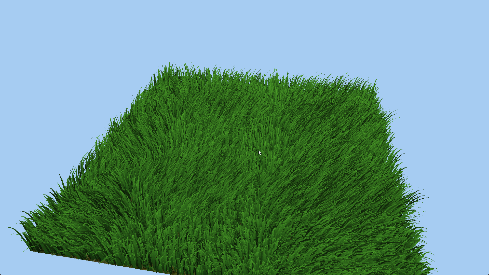
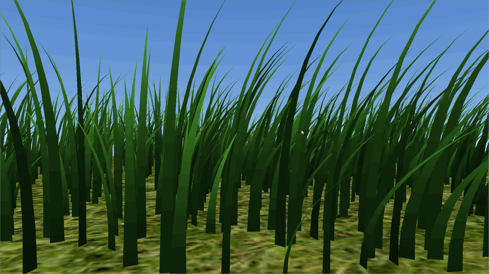
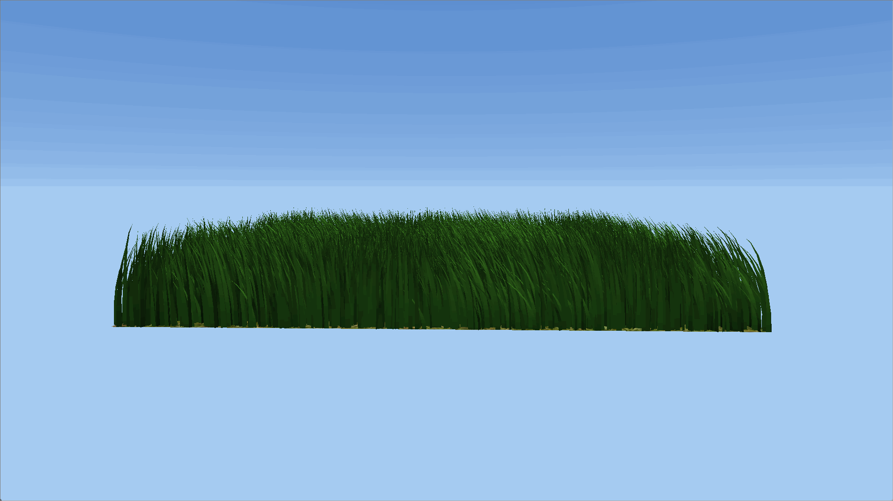
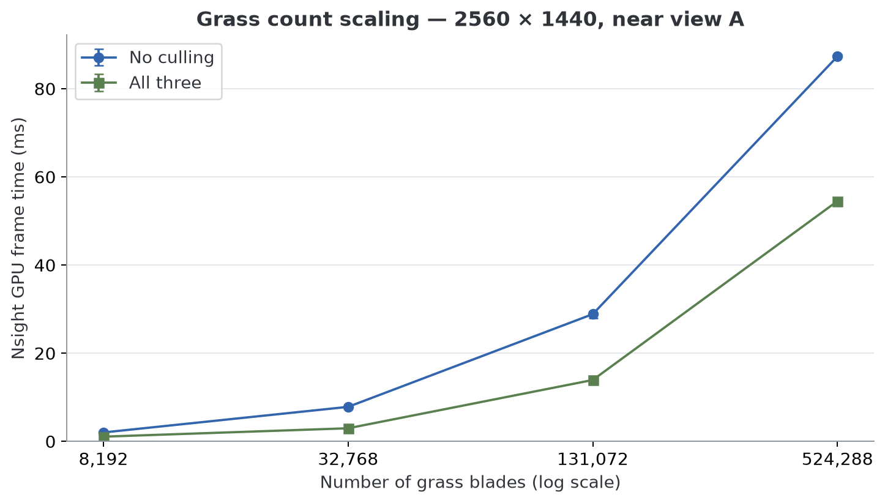
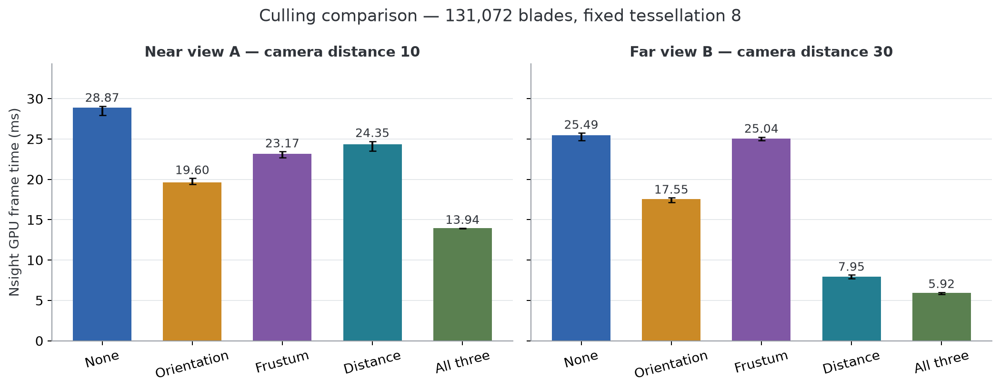
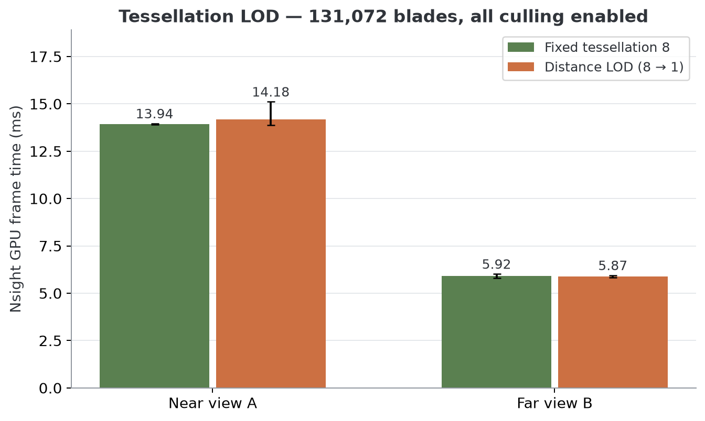

# Vulkan Grass Rendering

**University of Pennsylvania, CIS 565: GPU Programming and Architecture, Project 5**

- Sizhe Liu — [LinkedIn](https://www.linkedin.com/in/sizhe-liu-2726492b6/), [GitHub](https://github.com/JamesLiu12)
- Tested on: Windows 11 Pro, Intel Core i9-12900H @ 2.50 GHz, 32 GB RAM, NVIDIA RTX 3090 24 GB (personal computer)
- Vulkan SDK 1.4.350.0; Visual Studio 2022; Release build

This project simulates and renders a field of grass in Vulkan. Each blade starts as a quadratic Bézier curve, bends under gravity and wind, and becomes a tapered surface through hardware tessellation. A compute shader updates the grass and culls blades before they reach the graphics pipeline. I also added distance-based tessellation LOD, color variation, approximate light transmission, and a procedural sky with a day cycle.

The grass model and simulation follow Jahrmann and Wimmer's [Responsive Real-Time Grass Rendering for General 3D Scenes](https://www.cg.tuwien.ac.at/research/publications/2017/JAHRMANN-2017-RRTG/).


## Grass Representation

Instead of storing a triangle mesh for every blade, I store three control points and a few blade properties. The centerline is a quadratic Bézier curve:

$$
B(t) = (1-t)^2 v_0 + 2(1-t)t v_1 + t^2 v_2, \qquad t \in [0,1].
$$

The root `v0` stays fixed on the ground. Forces move the tip `v2`, while `v1` controls the bend and stays above the root along the blade's up vector. All the data fits into four `vec4`s:

| Field | `xyz` | `w` |
| --- | --- | --- |
| `v0` | Root position | Orientation angle |
| `v1` | Bézier guide | Rest height |
| `v2` | Simulated tip | Width |
| `up` | Up vector | Stiffness |

Heights range from 1.3 to 2.5, widths from 0.10 to 0.14, and stiffness coefficients from 7 to 13.

<p align="center">
  
</p>

Blade model illustration from the paper.

## Rendering Pipeline

The compute pipeline runs first, with one invocation per blade and 32 invocations per workgroup. It updates every blade's persistent simulation state, then applies the culling tests. Surviving blades are packed into a separate buffer with `atomicAdd`, which also updates the indirect draw's blade count.

The graphics pipeline reads that compacted buffer through `vkCmdDrawIndirect`. Each blade is one input vertex and one patch; tessellation generates its surface on the GPU.

| Shader | Role |
| --- | --- |
| `compute.comp` | Apply forces, correct the curve, cull blades, and write the visible blade list and draw count. |
| `grass.vert` | Transform control points into world space and calculate the blade's half-width vector. |
| `grass.tesc` | Choose the tessellation level from camera distance. |
| `grass.tese` | Evaluate the Bézier curve, taper the width toward the tip, and calculate normals and clip-space positions. |
| `grass.frag` | Shade the blade using its height, color variation, and sunlight. |

The blade count is reset before each compute dispatch, and memory barriers make the compute output available to vertex input and indirect drawing. Separate graphics pipelines draw the procedural sky and textured ground.

## Grass Simulation

### Gravity and Recovery

Gravity combines a downward environmental force with a smaller force toward the blade's front direction. The latter is one quarter of the environmental gravity's magnitude, giving each blade a preferred bending direction.

Recovery pulls the tip toward its original upright position:

$$
\mathbf{r} = (\mathbf{v}_{2,\mathrm{rest}} - \mathbf{v}_2)\,s,
\qquad
\mathbf{v}_{2,\mathrm{rest}} = \mathbf{v}_0 + h\,\mathbf{up}.
$$

Here, `s` is the blade's stiffness and `h` is its rest height. Stiffer blades resist bending more strongly. I update the tip using the sum of gravity, recovery, and wind, with the time step capped at 1/30 second to limit sudden jumps after a long frame.

### Wind

The wind direction changes with time and root position, so different parts of the field do not all lean the same way. Its strength combines a base value of 10 with 3D gradient noise at amplitude 3. Sampling the noise at positions advected over time adds moving patches of stronger and weaker wind.

I adapted the noise function from my earlier [Fireball project](https://github.com/JamesLiu12/hw01-fireball). It interpolates gradients at the eight corners of a grid cell using a quintic fade curve.

## Culling

All blades are simulated before culling, including those outside the camera view. This lets their motion continue while they are hidden. The following tests reduce the number of blades sent to tessellation.

### Orientation Culling

Grass blades are thin surfaces. When the camera looks almost along a blade's width direction, the surface appears edge-on and contributes very little to the image. I cull a blade when the absolute dot product between the view direction and its width direction exceeds **0.9**.

### View-Frustum Culling

I test the root, tip, and curve midpoint against the camera frustum. The midpoint is `B(0.5) = 0.25 v0 + 0.5 v1 + 0.25 v2`; the Bézier guide itself does not necessarily lie on the curve. A blade is discarded if none of these three points passes the clip-space test, using Vulkan's depth range of `0 ≤ z ≤ w`.

### Distance Culling

Distance culling gradually reduces density in four bands, up to a maximum distance of **40**. The distance is measured along the ground plane by removing the component along the blade's up vector.

| Ground-plane distance | Fraction passing the distance test |
| --- | --- |
| 0–10 | 100% |
| 10–20 | About 75% |
| 20–30 | About 50% |
| 30–40 | About 25% |
| 40 and beyond | 0% |

The selection uses the original blade index modulo four, so a blade keeps the same selection pattern while it stays in a band.



## Extra Credit Features

### Tessellation LOD

Nearby blades need enough segments to show their curvature, while distant blades can use much simpler geometry. In the tessellation control shader, I interpolate the requested longitudinal tessellation level from **8 at distance 5** to **1 at distance 30**, clamping outside that range. Distance here is the full camera-to-root distance.



### Grass Shading

I blend from dark green at the root to lighter green at the tip, then apply a small, stable per-blade brightness variation derived from the orientation angle. The gradient gives each blade more shape, and the variation breaks up large areas of identical green.

The lighting combines ambient light with two-sided diffuse lighting, using `abs(dot(normal, lightDirection))`. I also added an approximate transmission term: when the sun is behind a blade and the camera looks toward the light, the grass gains a warmer glow. This is a simple view-dependent approximation of light passing through a thin leaf.

### Procedural Sky and Day Cycle

The sun moves across the sky in a repeating cycle, with short intervals below the horizon. Low sunlight is warm orange, shifting toward pale white as the sun rises.

The sky is drawn with a fullscreen triangle. Each pixel reconstructs a world-space viewing direction and blends between horizon and zenith colors. I add an orange horizon near sunset and a small sun disk aligned with the lighting direction. The sky, grass, and ground share the same sun data, so the whole scene changes together.



## Performance Analysis

### Measurement Setup

The renderer runs in Release at 2560×1440, with NVIDIA driver 610.88 and Nsight Graphics 2026.3.1. The grass field stays 15×15, with random seed 5650, a fixed 1/60-second simulation step, and fixed sunlight. View A is at (0, 1, 10); view B is at (0, 1, 30). Both look toward (0, 1, 0) with a 45° vertical FOV.

The metric is Nsight's exported **GPU frame time**. Figures show the median of the three capture medians; error bars span their minimum and maximum.

### 1. Effect of Grass Count



View A, fixed tessellation level 8. Increasing blade count increases density within the same field. The horizontal axis uses a logarithmic scale.

| Blades | No culling (ms) | All three tests (ms) | Speedup |
| --- | --- | --- | --- |
| 8,192 | 2.039 | 1.082 | 1.88× |
| 32,768 | 7.845 | 2.986 | 2.63× |
| 131,072 | 28.874 | 13.938 | 2.07× |
| 524,288 | 87.328 | 54.510 | 1.60× |

Culling improves time at every tested density. At 524,288 blades, it reduces GPU frame time by **37.6%**. Cost still grows with blade count: every blade runs the physics simulation before culling. The tests save output writes and subsequent grass rendering, while the simulation remains O(N).

### 2. Individual Culling Tests



131,072 blades, fixed tessellation level 8. Each reduction is relative to no culling in the same view.

| Culling | View A (ms) | A reduction | View B (ms) | B reduction |
| --- | --- | --- | --- | --- |
| None | 28.874 | — | 25.491 | — |
| Orientation | 19.600 | 32.1% | 17.552 | 31.1% |
| Frustum | 23.167 | 19.8% | 25.038 | 1.8% |
| Distance | 24.346 | 15.7% | 7.948 | 68.8% |
| All three | 13.938 | 51.7% | 5.918 | 76.8% |

Orientation culling helps both views. Frustum culling helps view A, while its small difference in view B falls within the repeat spread. All blade roots are inside the far camera's frustum, leaving this test no blades to reject there.

Distance culling benefits the far view most. Its blades fall in the 20–40 distance bands, where only half or one quarter pass the distance test. This trades distant grass density for speed. Combining all three tests reduces time by **51.7% in A** and **76.8% in B**. Their gains overlap and should not be added.

### 3. Tessellation LOD



131,072 blades, all three culling tests enabled. Only the tessellation setting changes.

| View | Fixed level 8 | Distance LOD | Time change |
| --- | --- | --- | --- |
| A | 13.938 ms | 14.179 ms | +1.7% |
| B | 5.918 ms | 5.873 ms | −0.8% |

LOD shows no clear frame-time improvement in these two views: the repeat ranges overlap in both comparisons. It reduces tessellation detail but leaves simulation and compaction unchanged, and adds distance calculations per patch. The frame totals do not isolate which stage limits performance.

## Run Locally

Clone the repository with submodules, then configure and build from PowerShell:

```powershell
git clone --recursive https://github.com/JamesLiu12/Project5-Vulkan-Grass-Rendering.git
cd Project5-Vulkan-Grass-Rendering

cmake -S . -B build -G "Visual Studio 17 2022"
```

| Control | Action |
| --- | --- |
| Left mouse drag | Orbit the camera |
| Right mouse drag vertically | Zoom in or out |

## References and Credits

- [CIS 5650 Vulkan Grass Rendering starter](https://github.com/CIS5650-Fall-2026/Project5-Vulkan-Grass-Rendering)
- Klemens Jahrmann and Michael Wimmer, [Responsive Real-Time Grass Rendering for General 3D Scenes](https://www.cg.tuwien.ac.at/research/publications/2017/JAHRMANN-2017-RRTG/), I3D 2017 — grass representation, simulation, and culling reference.
- My [Fireball project](https://github.com/JamesLiu12/hw01-fireball) — source of the adapted noise function.
- [GLFW](https://github.com/glfw/glfw), [GLM](https://github.com/g-truc/glm), and [stb_image](https://github.com/nothings/stb) — window/input handling, math, and texture loading.